<div align="center">

# 🌡️ Heat Planner

**Plan your heating around electricity prices, who's home and how each room behaves – and see exactly why it does what it does.**

[](https://hacs.xyz/docs/faq/custom_repositories/)
[](https://github.com/aridder/ha-heat-planner/releases)
[](https://github.com/aridder/ha-heat-planner/actions/workflows/validate.yml)
[](LICENSE)

[](https://my.home-assistant.io/redirect/hacs_repository/?owner=aridder&repository=ha-heat-planner&category=integration)
[](https://my.home-assistant.io/redirect/config_flow_start/?domain=heat_planner)

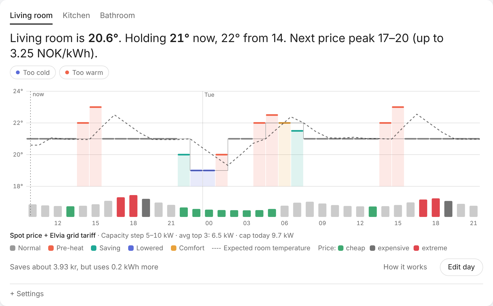

</div>

Heat Planner is an integration **and** a dashboard card. For every heated room it builds an hour‑by‑hour plan for the next 36 hours, sets your thermostats to follow it, and shows you the plan – price, target, expected room temperature and cost – with a reason for every hour. Drag across the hours to change it.

It plans with what you actually pay per kWh – spot, spot with Norwegian strømstøtte, or a fixed price like Norgespris, plus the grid tariff – can keep the month's capacity step (effekttrinn) down by spreading heat between rooms, and tells you honestly what price control saves and what it costs in extra kWh or comfort.

Built for electric floor heating in the Nordics, but it works with any `climate` entity and any price source.

<sub>The screenshots use made‑up example data for a home in Oslo, run through the integration's own planner and card (see [`tools/docs`](tools/docs)).</sub>

> **Status:** early (0.x). Used daily in a real home in Oslo. Feedback and issues are very welcome.

---

## Contents

- [Why Heat Planner](#why-heat-planner)
- [Features](#features)
- [How it works](#how-it-works)
- [Norway: Norgespris, strømstøtte and effekttrinn](#norway-norgespris-strømstøtte-and-effekttrinn)
- [Requirements](#requirements)
- [Installation](#installation)
- [Setup](#setup)
- [Everyday use](#everyday-use)
- [Card configuration](#card-configuration)
- [Entities](#entities)
- [Services and automations](#services-and-automations)
- [How it compares](#how-it-compares)
- [FAQ](#faq)
- [Roadmap](#roadmap)
- [Contributing](#contributing)
- [Norsk](#norsk)

---

## Why Heat Planner

Most price‑aware heating setups are a pile of template sensors and automations that nobody in the house understands – and that silently leave a room cold. Heat Planner tries to be the opposite:

- **One plan you can see.** Not a black box: a 36‑hour plan with the expected room temperature and the cost.
- **Comfort first.** You draw how warm you want it. Prices only decide *when* heat is used, inside limits you set – never below a safety temperature.
- **Honest about money.** It plans with your real contract and grid tariff, and says so plainly when price control saves almost nothing.
- **Plays nicely with people.** Turn a thermostat by hand and Heat Planner steps back until the next change in the plan.
- **Set up in minutes.** It finds your thermostats, sets up Nord Pool and a weather forecast for you, and can even let an AI draft the schedules.

## Features

| | |
|---|---|
| 🗓️ **Day curves you paint** | One curve per weekday plus one‑off curves for a single date. Drag across the hours in the card; save for *only that day*, *every Monday*, *weekdays*, *weekend* or *all days*. |
| 🧾 **Your real price** | Electricity contract (spot, spot with strømstøtte, or a fixed price such as Norgespris) plus the grid tariff's day/night energy charge (Elvia 2026 preset or your own numbers), VAT and other add‑ons. |
| 🧮 **Optimiser** | Chooses every hour's target by dynamic programming over the room model: lowest cost for the comfort you asked for, within your price strategy, protected window, safety temperature and max hours off. On by default for new setups; the price rules are one switch away. |
| ⚡ **Price rules** | Lower in the day's most expensive hours, pre‑heat cheap hours before them, store heat before an extreme price and switch off in it. Strategy per room: ignore, gentle, balanced or aggressive. |
| 📉 **Capacity tariff (effekttrinn)** | With a whole‑house power meter (Tibber Pulse, HAN reader …) it sets a cap for every hour so the month's three highest hours stay in the current step, spreads heating between rooms to stay under it, and a live guard sets rooms back when the current hour is heading over. |
| 🏠 **Presence & arrival** | Lower the temperature while nobody is home. Set *Warm again from* to **Auto** and it learns when you usually get home, weekday by weekday, and starts warming in time. |
| 🧠 **Learns each room** | Every night it reads the recorder to learn how fast each room heats and cools, how much the sun helps, how slowly a floor responds, and how much power each heater draws – and shows how well the model fits (good / fair / uncertain). |
| 🔮 **Expected temperature & honest savings** | A room model, the weather forecast and the sun predict the temperature hour by hour. One line gives the saving versus the same curve without price control, the extra kWh pre‑heating uses, and any loss of comfort. |
| 🙋 **Too cold / Too warm** | Two buttons in the card. Each tap nudges one setting by a small, bounded step and tells you what it changed. |
| 💬 **Explains itself** | Point at any hour: price, target and *why*. A built‑in, illustrated guide explains the rest. |
| ✋ **Respects manual changes** | Detects setpoint and on/off changes made by hand and pauses until the next plan change. |
| 🛟 **Safety net** | Never off below a safety temperature, at most N hours off in a row, and normal heating restored if prices or planning fail. |
| 🧩 **Floor heating without a sensor** | Thermostats in regulator mode are controlled in percent through their `number` entity. |
| 🪄 **Guided setup** | Auto‑discovery, Nord Pool and Met.no set up for you, house description, optional AI‑drafted schedules. |
| 🌍 **English & Norwegian** | Integration, card and guide. |

## How it works

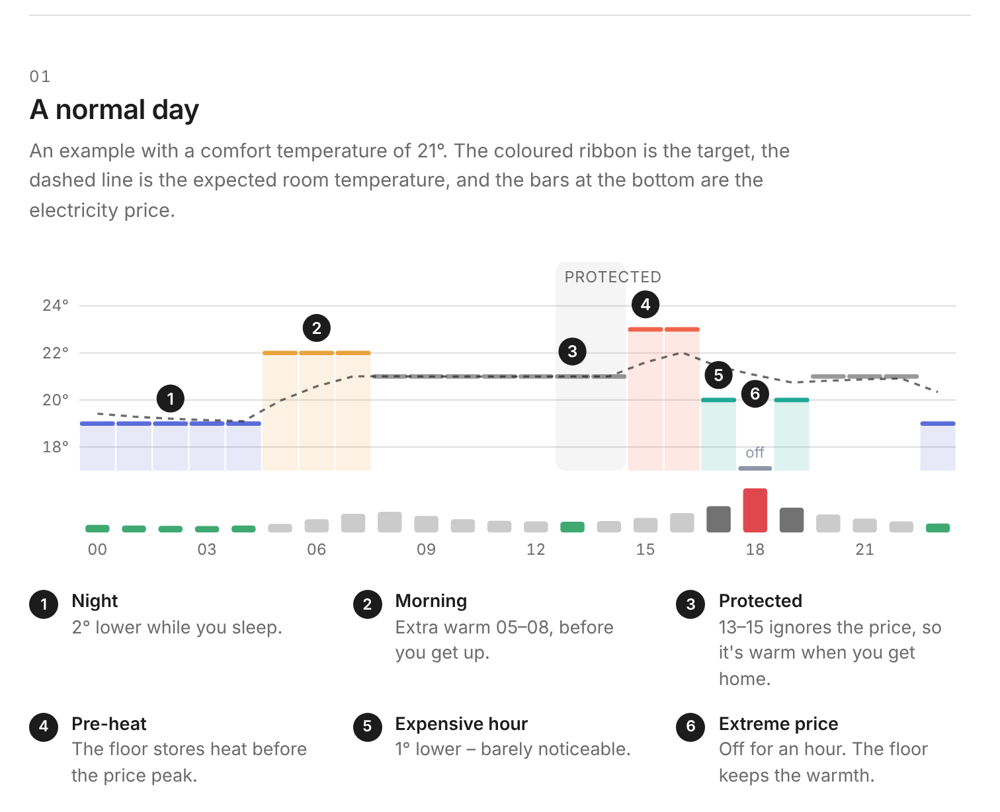

1. **Night** – lower while you sleep. 2. **Morning** – extra warm before you get up. 3. **Protected window** – prices are ignored so it's warm when you get home. 4. **Pre‑heat** – the floor stores heat before the peak. 5. **Expensive hour** – 1° lower. 6. **Extreme price** – off for an hour; the floor keeps the warmth.

<details>
<summary><b>The price rules</b></summary>

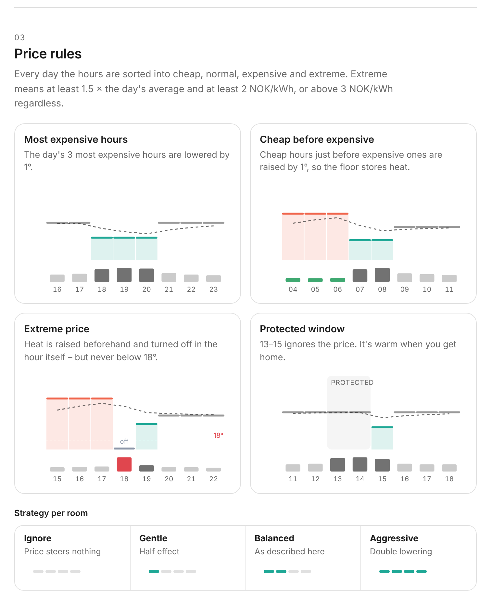

| Situation | Effect (defaults) |
| --- | --- |
| One of the day's 3 most expensive hours | Lower by 1 °C |
| Cheap hour with expensive hours within 3 h | Raise by 1 °C to store heat |
| Extreme price ahead (≥ 1.5 × day average and ≥ 2/kWh, or ≥ 3/kWh) | Raise by 2 °C beforehand |
| Extreme price now | Heating off – never below the safety temperature, at most 2 h in a row |
| Protected window (default 13–15) | Prices ignored |

All thresholds and amounts can be changed per room in the card.
</details>

<details>
<summary><b>The optimiser</b></summary>

New setups plan with an optimiser instead of the fixed rules above. It starts from the same day curve, away setback and protected window, and re‑chooses each hour's target from a small set of steps by dynamic programming over the room's own model, minimising energy cost + a comfort penalty (+ a penalty above the capacity cap). It only pre‑heats when the model says storing heat in the floor is cheaper than heating in the expensive hours – including the extra losses of a warmer room – and it keeps to:

- your price strategy and the *lower in expensive hours* / *raise before expensive hours* amounts,
- the protected window (no price savings there),
- the safety temperature, and *off* only in extreme hours, at most *max hours off* in a row.

Turn **Optimise (all rooms)** off under **Settings** in the card to go back to the price rules.
</details>

<details>
<summary><b>Your contract and the grid tariff</b></summary>

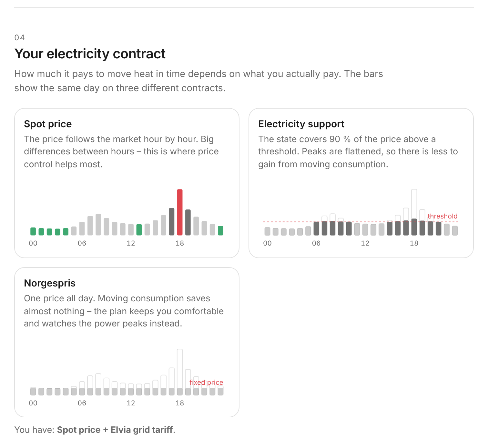

Every hour is planned with the effective price per kWh:

| Contract | Energy part |
| --- | --- |
| Spot price | Spot + VAT |
| Spot price with strømstøtte | Spot minus 90 % of what is above 0.77/kWh ex. VAT, + VAT |
| Fixed price (e.g. Norgespris) | Your fixed price incl. VAT (default 0.50) – spot is ignored and may be missing |

On top comes the grid tariff's energy charge – *Elvia 2026* (36.40 øre weekdays 06–22, 26.40 øre nights and weekends) or your own day/night prices – and any other cost per kWh. No VAT is added in NO4 (Northern Norway). Public holidays are not treated as night yet. A day where prices differ by less than 0.15/kWh has nothing worth shifting: every hour counts as *normal*.
</details>

<details>
<summary><b>Capacity tariff (effekttrinn)</b></summary>

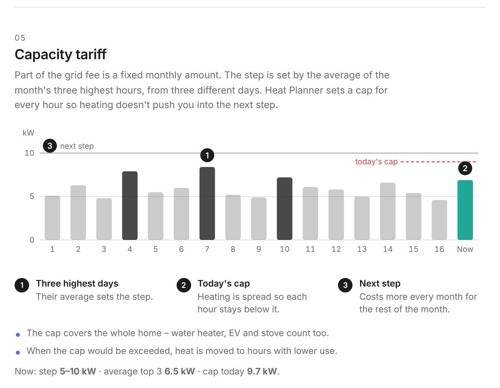

Part of the Norwegian grid fee is a monthly step set by the average of the month's three highest hours, on three different days (the Elvia 2026 steps are built in). With **Keep the monthly peak low** on and a whole‑house power meter selected, Heat Planner:

1. reads the meter's statistics to see where the month stands and sets a **cap for every plan hour** – 0.3 kW below the next step, never below 3 kW;
2. estimates the rest of the house (a low, 25th‑percentile load per hour of day) and, where house + heating would cross the cap, **lowers rooms a little in those hours**, spread between rooms. Protected hours and rooms close to their safety temperature are never cut, and cuts are dropped again on days where they would not lower that day's peak;
3. runs a **live guard**: from the meter it projects the energy the current clock hour will end at, and if that is over the cap it sets rooms back (−2 °C, or −20 % for percent rooms) for the rest of the hour.

The card shows the step, the month's top‑3 average and today's cap under the plan. Without a whole‑house meter, capacity limiting stays off – it needs the real peaks.
</details>

<details>
<summary><b>When you're away</b></summary>

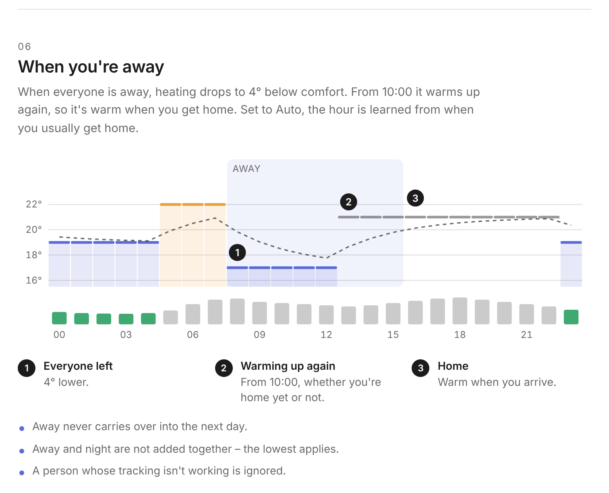

When everyone is away, the room drops to *comfort − 4 °C* (configurable) until a set hour, then warms up again. Away never carries into the next day, and away and night setbacks are not added together.

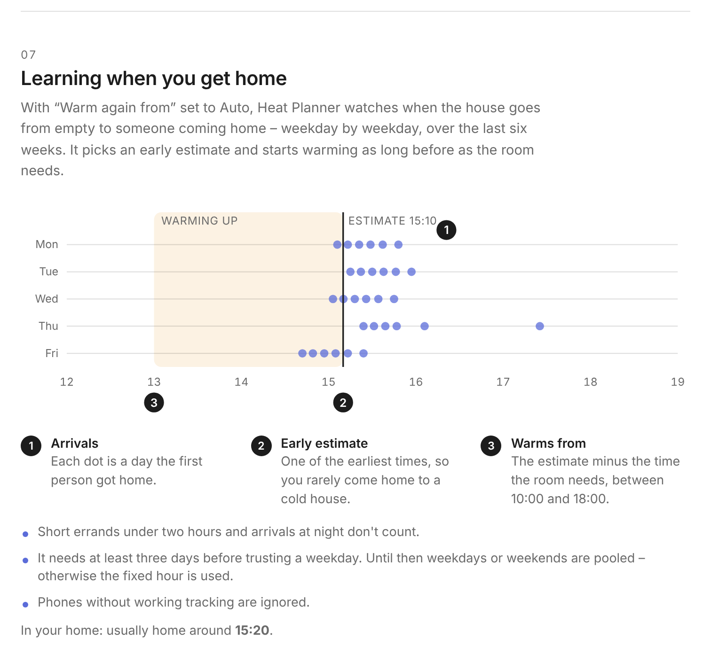

With *Warm again from* set to **Auto** (and learning from history allowed), the hour is learned from when the house goes from empty to someone home, over the last six weeks. Errands under two hours and arrivals between 00 and 05 don't count; a weekday needs three arrivals, otherwise weekdays or weekends are pooled, otherwise the fixed hour is used. It takes an early estimate (25th percentile) and starts warming as long before as the room needs, between 10:00 and 18:00.
</details>

<details>
<summary><b>Taking over by hand</b></summary>

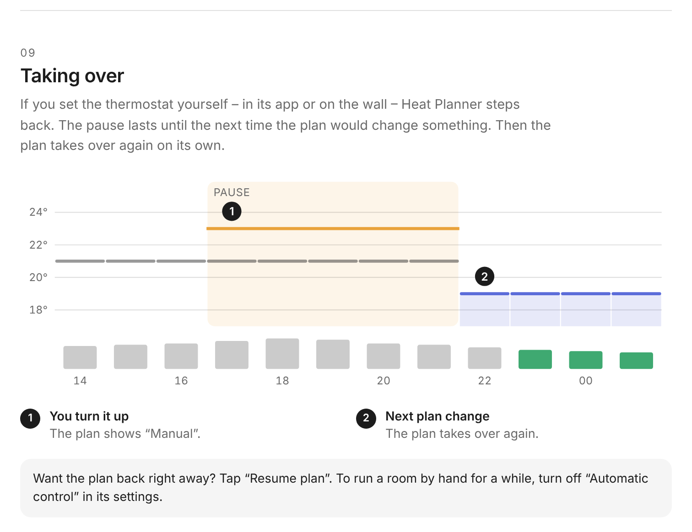
</details>

<details>
<summary><b>Safety net and learning</b></summary>

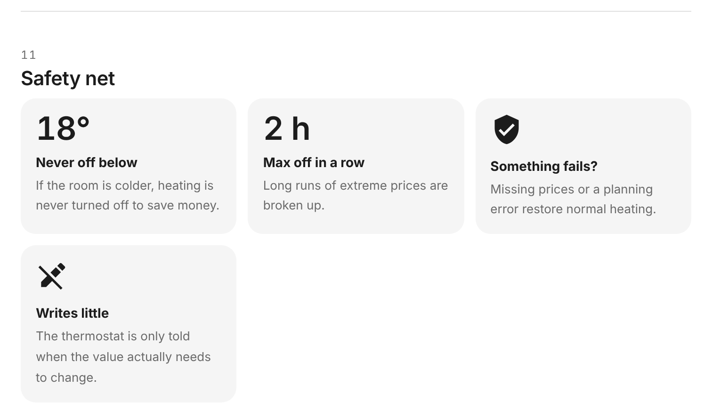
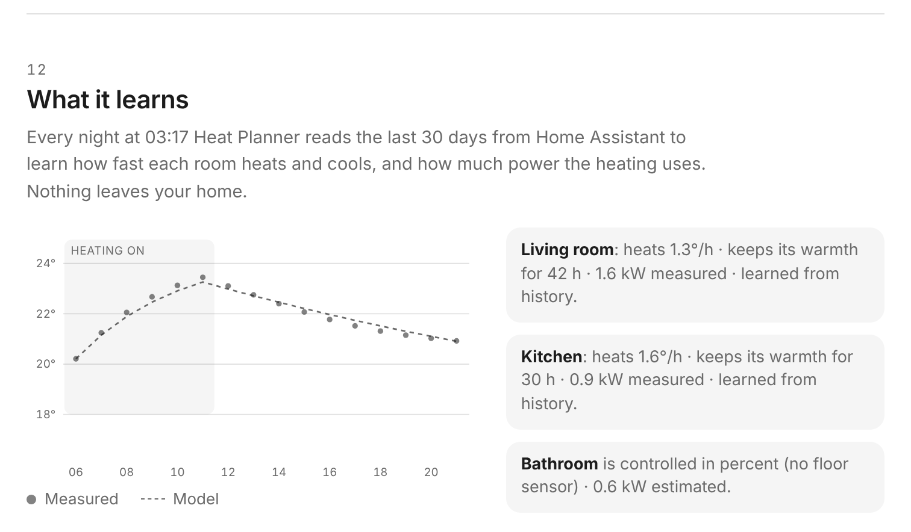
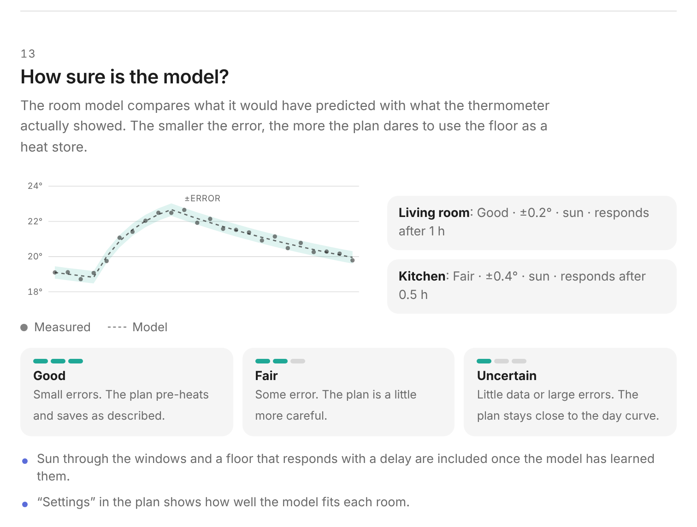

The room model learns heating rate, heat loss, **solar gain** (from the sun's position and the forecast's cloud cover) and **floor lag** (the delay before heat shows in the room). Its fit error decides the label in the card: *good* (under ±0.3 °C), *fair* (under ±0.6 °C) or *uncertain*.
</details>

## Norway: Norgespris, strømstøtte and effekttrinn

What is worth doing depends on your contract. Pick it in the step **Electricity contract and capacity tariff**:

| You have | What Heat Planner does |
| --- | --- |
| **Spot price** | Moves heat away from expensive hours when the room model says it pays. This is where price control saves the most. |
| **Spot with strømstøtte** | Plans with the price *after* support. Above 0.77 kr/kWh ex. VAT you pay only 10 % of the rest, so peaks are flattened and there is much less to gain – expect the savings line to say so. |
| **Norgespris / fixed price** | The energy price is the same every hour, so moving heat saves almost nothing. What is left is the grid tariff's **day/night difference** (Elvia: 36.40 vs 26.40 øre) and, with a whole‑house meter, **keeping the capacity step down**. Schedules, presence, the room model and the safety net work as before, and planning keeps going even when spot prices are missing. |

**Effekttrinn** applies whatever your contract is, and for direct electric heating it is often worth more than price shifting: one step up costs extra for the whole month. Turn on *Keep the monthly peak low* and pick your Tibber Pulse or HAN reader.

## Requirements

- Home Assistant **2025.6** or newer
- One or more `climate` entities that support `heat` (or a `number` for heating demand in regulator mode)
- A price source – any of:
  - the core **[Nord Pool](https://www.home-assistant.io/integrations/nordpool/)** integration (set up for you if missing)
  - **[Tibber](https://www.home-assistant.io/integrations/tibber/)**
  - a price sensor with hourly or 15‑minute prices in its attributes: [Nordpool (HACS)](https://github.com/custom-components/nordpool), [ENTSO‑e](https://github.com/JaccoR/hass-entso-e), [Energi Data Service](https://github.com/MTrab/energidataservice) …
- Optional: `person` entities for presence, a **whole‑house power sensor** (Tibber Pulse, HAN/AMS reader) for capacity‑tariff limiting, a `weather` entity with an hourly forecast (Met.no is set up for you), room temperature sensors, power sensors, and an [AI Task](https://www.home-assistant.io/integrations/ai_task/) entity.

## Installation

### HACS (recommended)

1. Click the button above, or in HACS go to **⋮ → Custom repositories**, add `https://github.com/aridder/ha-heat-planner` as **Integration**.
2. Search for **Heat Planner** and **Download**.
3. **Restart** Home Assistant.

### Manual

Copy `custom_components/heat_planner` into your `config/custom_components/` folder and restart.

The card and the guide are served by the integration itself – **no Lovelace resource to add**.

## Setup

**Settings → Devices & services → Add integration → Heat Planner**, or use the button above.

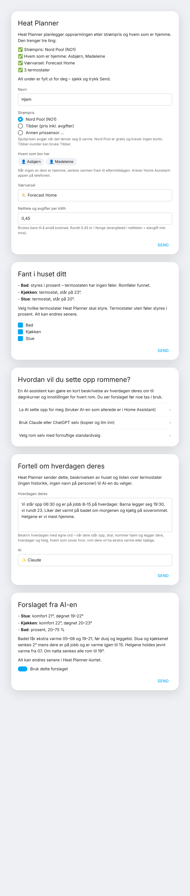

1. **Price & presence** – a checklist shows what was found. No price source? Heat Planner can set up Nord Pool for you (free, no account; the price area is guessed from your home location). No weather forecast? Met.no is added.
2. **About your home** – type of home, insulation, heated area and heating sources. This gives every room a sensible starting model.
3. **Electricity contract and capacity tariff** – your contract (spot, spot with strømstøtte, or fixed price incl. VAT), the grid tariff (Elvia 2026, your own day/night prices, or not included), any other cost per kWh, and whether the price source already includes VAT (Tibber and many HACS sensors do; core Nord Pool does not). Turn on **Keep the monthly peak low** and pick a whole‑house power meter for capacity‑tariff limiting. In Norway it suggests spot with strømstøtte, Elvia in NO1, and peak limiting when a meter is found.
4. **Set up the rooms** – pick one:
   - **Let AI set it up** – if Home Assistant has an AI Task entity (Claude, ChatGPT, Gemini …), describe your everyday life in your own words and get day curves and settings for every room.
   - **Use Claude or ChatGPT yourself** – copy a ready‑made text into any chat assistant and paste the answer back.
   - **Pick rooms yourself** with sensible defaults.

   You always review the proposal first. Only the house description, your text and the list of thermostats are sent – never history or names of people. Every answer is validated and clamped to safe limits.
5. **Found in your home** – the thermostats it found (vehicles and other non‑room climate entities are skipped), with the room sensor and power meter next to each, and whether to control by temperature or by percent.
6. **Learn from history** – with your permission it reads the last 30 days from the recorder (room temperatures, heater power and, for Auto warm‑up, when people get home). Nothing leaves Home Assistant.

Later, **Configure** lets you find new thermostats, add/edit/remove rooms, change the house description or the electricity contract and capacity tariff, and turn learning on or off.

Then add the card to a dashboard:

```yaml
type: custom:heat-planner-card
```

> **Switching from your own automations?** Turn off any automations that set the same thermostats, or they will fight each other. Heat Planner will see their changes as manual changes and pause.

## Everyday use

**Read the plan.** Tabs pick the room. The sentence at the top says what's happening now and next. The coloured ribbon is the target, the dashed line is the expected room temperature, the bars are the price you actually pay. Point at or tap an hour to see why – including *chosen by the optimiser* and *keeping the monthly peak down*. Under the chart: your contract and, with peak limiting, the capacity step, the month's top‑3 average and today's cap. At the bottom, one honest line, e.g. *“Saves about 3.93 kr, but uses 0.2 kWh more”* or *“Price control saves almost nothing today”*.

**Too cold? Too warm?** Tap a button under the sentence. One small, bounded change is made, and the card tells you what it was:

| You tap | while the plan was … | Change |
| --- | --- | --- |
| Too cold | saving for price | lowers 0.5° less in expensive hours (and raises *never cut off below* 0.5° if the room was close to it) |
| Too cold | lowered because nobody was home | lowers 0.5° less when away |
| Too cold | anything else | comfort +0.5° |
| Too warm | pre‑heating | pre‑heats 0.5° less |
| Too warm | anything else | comfort −0.5° |

Percent rooms change by 5 percentage points. A night setback in your own day curve is left alone – change it with *Edit day*. The same tap within ten minutes counts once, so two people pressing at once is fine.

<details>
<summary><b>How the guide explains it</b></summary>

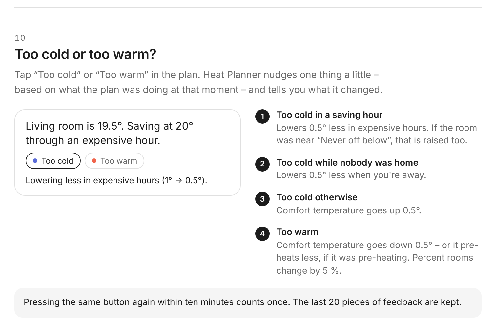
</details>

**Change a day.** Tap **Edit day** → pick a day → drag across the hours. Temperature and cost update while you drag. Choose how long it applies, and **Save**. **Back to schedule** removes a one‑day change.

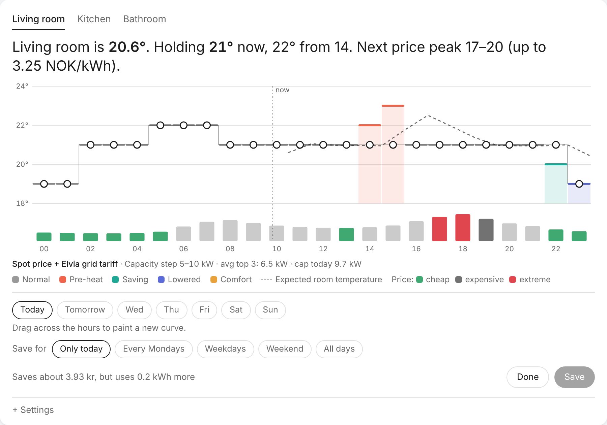

**Tune a room.** Open **Settings** under the plan: automatic control, **Optimise (all rooms)**, comfort temperature, price strategy, how much to lower and raise, extreme‑price cut‑off, safety temperature, away setback, when it should be warm again (a fixed hour or **Auto**), and the protected window. The note at the bottom describes the room model: how fast it heats, how well it fits, whether it accounts for sun and floor lag, and the heater's power.

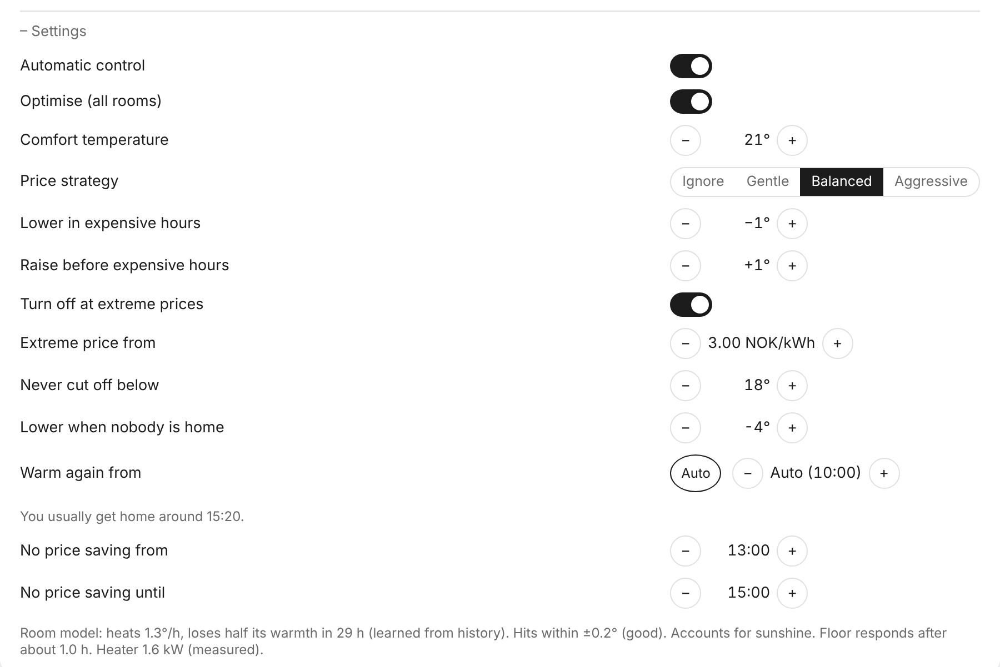

**Take over.** Just use the thermostat. The card shows **Manual** and when the plan resumes; tap **Resume plan** to hand back control right away. To run a room by hand for longer, turn off **Automatic control** – normal heating is restored so it isn't left off.

**Need a refresher?** Tap **How it works** in the card for the illustrated guide, in English or Norwegian.

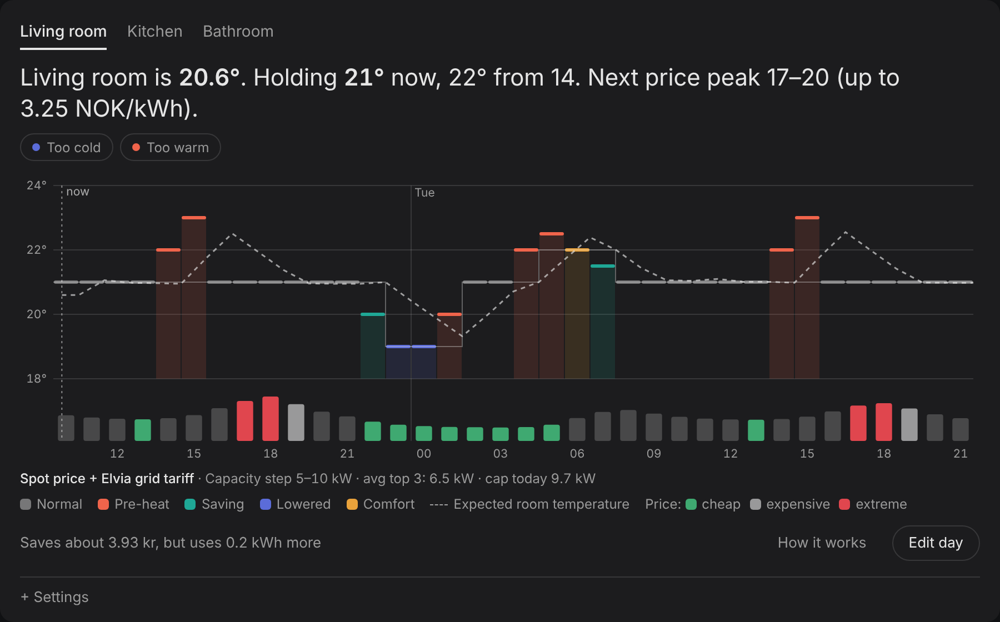

## Card configuration

```yaml
type: custom:heat-planner-card
zones: [stue, kjokken]   # optional – default: all rooms
hours: 36                # optional – hours shown, default 36
entry_id: 01ABC…         # optional – if you have more than one Heat Planner
```

The guide can also live on its own view:

```yaml
type: custom:heat-planner-help-card
language: en             # optional – en or nb, default follows Home Assistant
```

## Entities

Per room (one device per room):

| Entity (room `stue`) | | |
|---|---|---|
| `sensor.stue_target` | Target | What the plan asks for now (°C or %) |
| `sensor.stue_mode` | Mode | `normal`, `comfort`, `setback`, `preheat`, `save`, `off`, `away` |
| `sensor.stue_predicted_temperature` | Predicted temperature | Expected room temperature this hour |
| `sensor.stue_estimated_cost_next_24_h` | Estimated cost next 24 h | Based on the plan and prices |
| `sensor.stue_estimated_savings_next_24_h` | Estimated savings next 24 h | Compared with the same curve without price control |
| `switch.stue_automatic_control` | Automatic control | Turn Heat Planner on/off for the room |
| `number.stue_comfort_temperature` | Comfort temperature | The base the curve is built on |
| `select.stue_price_strategy` | Price strategy | `off`, `gentle`, `balanced`, `aggressive` |

Per home (home `hjem`):

| Entity | | |
|---|---|---|
| `sensor.hjem_price_level` | Price level | `cheap`, `normal`, `expensive` or `extreme` |
| `sensor.hjem_effective_electricity_price` | Effective electricity price | This hour's price per kWh incl. contract and grid tariff (attribute `tariff`) |
| `sensor.hjem_savings_this_month` | Savings this month | Realised estimate: each finished hour's cost without price control minus the planned cost, as planned at the start of that hour. Kept across restarts |
| `sensor.hjem_savings_today` | Savings today | The same, for today |
| `sensor.hjem_capacity_tariff_step` | Capacity tariff step | e.g. `5–10 kW`, with `step_cost`, `next_step_kw`, `top3_kw`, `month_avg_kw`, `cap_kw_today` (only with capacity limiting) |
| `sensor.hjem_monthly_peak_average` | Monthly peak average | Average of the month's three highest daily peaks (kW) |
| `sensor.hjem_peak_headroom_this_hour` | Peak headroom this hour | Today's cap minus this hour's projected energy, live from the house meter |

### Alerts

Heat Planner fires the event `heat_planner_alert` with `kind`, `message` and `entry_id` (plus details) for:

* `peak_risk` – this hour is heading within 0.3 kW of today's cap (at most once per hour)
* `extreme_price_tomorrow` – tomorrow's prices are in and contain an extreme hour (once per day)
* `model_poor` – a room's learned heating model fits poorly (once, again only after it recovered)

Under *Configure → Alerts* you can also have them sent to a notify service (`notify.mobile_app_…`) and pick which kinds; the message follows Home Assistant's language (Norwegian or English).

## Services and automations

| Service | What it does |
|---|---|
| `heat_planner.set_schedule` | Set 24 hourly values for `all` days, `weekdays`, `weekend`, selected `days` or one `date` |
| `heat_planner.clear_override` | Go back to the standing schedule for a date |
| `heat_planner.resume` | End a manual pause |

<details>
<summary><b>Example: a lie‑in on public holidays</b></summary>

```yaml
action: heat_planner.set_schedule
data:
  zone: stue
  scope: date
  date: "2026-12-26"
  values: [-2,-2,-2,-2,-2,-2,-2,0,1,1,1,0,0,0,0,0,0,0,0,0,0,0,0,-2]
```
Values are offsets from the comfort temperature (or percent for percent rooms).
</details>

<details>
<summary><b>Example: tell me when an extreme price switches heating off</b></summary>

```yaml
triggers:
  - trigger: state
    entity_id: sensor.stue_mode
    to: "off"
actions:
  - action: notify.mobile_app_phone
    data:
      message: "Heating in the living room is off for an hour – extreme electricity price."
```
</details>

<details>
<summary><b>Example: pause price control while you have guests</b></summary>

```yaml
action: select.select_option
target:
  entity_id: select.stue_price_strategy
data:
  option: "off"
```
</details>

Entity IDs follow your room names.

## How it compares

There are great projects nearby. Heat Planner's angle is **a plan people can see, understand and edit**, tuned for price‑driven electric heating.

| | Heat Planner | [RoomMind](https://github.com/snazzybean/roommind) | [EMHASS](https://github.com/davidusb-geek/emhass) | [Versatile Thermostat](https://github.com/jmcollin78/versatile_thermostat) | [PriceAnalyzer](https://github.com/erlendsellie/priceanalyzer) | [Scheduler card](https://github.com/nielsfaber/scheduler-card) |
|---|:-:|:-:|:-:|:-:|:-:|:-:|
| Electricity price aware | ✅ | – | ✅ | – | ✅ | – |
| Contract & grid tariff modes (spot / support / fixed, day‑night) | ✅ | – | ➖ ⁴ | – | ? | – |
| Learns a model of each room | ✅ | ✅ | – ¹ | ➖ ² | – | – |
| Forward plan you can see | ✅ | ? | ✅ | – | – | ✅ |
| Paint schedules in the dashboard | ✅ | – | – | – | – | ➖ ³ |
| Expected room temperature | ✅ | ? | ✅ | – | – | – |
| Cost & savings estimate | ✅ | – | ✅ | – | – | – |
| Comfort feedback (too cold / too warm) | ✅ | – | – | – | – | – |
| Explains every hour | ✅ | – | – | – | – | – |
| Presence | ✅ ⁵ | ✅ | – | ✅ | – | ➖ |
| Respects manual changes | ✅ | ? | – | n/a | – | – |
| True optimiser (MPC/LP/DP) | ✅ | ✅ | ✅ | – | – | – |
| Solar gain | ✅ | ✅ | ➖ | – | – | – |
| Power / capacity‑tariff limiting | ✅ ⁶ | – | ➖ | ✅ | – | – |
| Guided setup | ✅ | ➖ | – | ➖ | – | – |

✅ yes · ➖ partly · – no · ? not documented. ¹ parameters set by hand · ² auto‑tuned TPI · ³ time slots, not a curve · ⁴ any price series you feed it · ⁵ learns when you get home · ⁶ needs a whole‑house power meter.
Based on each project's public documentation, October 2026 – corrections welcome.

## FAQ

<details><summary><b>A room isn't following the plan.</b></summary>
If the card says <b>Manual</b>, someone changed the thermostat. Tap <b>Resume plan</b> or wait for the next plan change. Also check that no other automation sets the same thermostat.
</details>
<details><summary><b>Only today's prices are shown.</b></summary>
Day‑ahead prices are published around 13:00 CET and fetched automatically. Until then, hours after midnight follow the day curve.
</details>
<details><summary><b>I'm on a fixed price (e.g. Norgespris).</b></summary>
Choose <b>Fixed price</b> under Configure → <i>Electricity contract and capacity tariff</i>. Heat Planner then plans with your fixed price plus the grid tariff's day/night charge, so it only shifts heat where the grid tariff makes it worth it – and with a whole‑house meter it keeps your capacity step down. See <a href="#norway-norgespris-strømstøtte-and-effekttrinn">Norway</a>.
</details>
<details><summary><b>The savings line says “almost nothing”.</b></summary>
That's honest, not a bug: with strømstøtte, a fixed price or a flat price day there is little to gain from moving heat. The line also tells you when pre‑heating uses extra kWh or the room ends up colder than your curve.
</details>
<details><summary><b>Capacity limiting doesn't show up.</b></summary>
It needs <i>Keep the monthly peak low</i> turned on <b>and</b> a whole‑house power sensor (W or kW) with long‑term statistics in the recorder. The step and today's cap appear under the plan once there is history.
</details>
<details><summary><b>I upgraded from 0.2 – is the optimiser on?</b></summary>
Older setups keep the price rules until you turn on <b>Optimise (all rooms)</b> in the card's settings or save the new contract step under Configure. New setups start with the optimiser.
</details>
<details><summary><b>Does it work with 15‑minute prices?</b></summary>
Yes. Quarter‑hour prices are averaged to hours for planning.
</details>
<details><summary><b>Does any data leave my home?</b></summary>
No. Planning and learning happen in Home Assistant. Only if you choose AI‑assisted setup is a description of the house, your text and the list of thermostats sent to the AI you picked.
</details>
<details><summary><b>Heat pumps, radiators, water‑based floors?</b></summary>
Anything exposed as a <code>climate</code> entity with a heat mode works. The house description gives each room a sensible starting model; learning refines it.
</details>

## Roadmap

- Occupancy beyond arrival – when you leave, which rooms are used
- Per‑room priorities in the UI (which room gives way first under the capacity cap)
- Presets for more grid companies (energy charge and capacity steps), not just Elvia
- Public holidays as night/weekend in the grid tariff

## Contributing

Issues and pull requests are welcome.

```bash
pip install pytest-homeassistant-custom-component
pytest
```

The card and guide are plain JavaScript with no build step (`custom_components/heat_planner/frontend/`).

The screenshots in `docs/` are rendered from the real card and guide with example data: `python3 tools/docs/shoot.py` (needs Playwright with Chromium).

---

## Norsk

**Heat Planner planlegger oppvarmingen etter strømpris, hvem som er hjemme og hvordan hvert rom oppfører seg – og viser hvorfor.** Integrasjonen, kortet og veiledningen er på norsk.

**Slik kommer du i gang**

1. Trykk HACS‑knappen øverst, eller legg til `https://github.com/aridder/ha-heat-planner` som *Integration* under HACS → ⋮ → Egendefinerte repositorier. Last ned og start Home Assistant på nytt.
2. **Innstillinger → Enheter og tjenester → Legg til integrasjon → Heat Planner.** Oppsettet finner termostatene dine, setter opp Nord Pool og værvarsel om det mangler, og kan la en AI lage døgnkurvene.
3. Legg kortet på et dashbord: `type: custom:heat-planner-card`.
4. Skru av egne automasjoner som styrer de samme termostatene.

**Strømavtale og effekttrinn:** i oppsettet velger du strømavtale (spotpris, spotpris med strømstøtte eller fastpris som Norgespris), nettleie (Elvia 2026 eller egne dag/natt‑priser) og om månedens effekttopp skal holdes lav. Det siste krever en strømmåler for hele huset (Tibber Pulse, HAN‑leser). Heat Planner setter da et tak for hver time, fordeler varmen mellom rommene og senker rom resten av timen hvis timen er på vei over taket.

| Du har | Det Heat Planner gjør |
| --- | --- |
| **Spotpris** | Flytter varme bort fra dyre timer når rommodellen sier det lønner seg. |
| **Spotpris med strømstøtte** | Planlegger med prisen etter støtte. Toppene blir flate, så det er mye mindre å hente – og det står i sparelinjen. |
| **Norgespris / fastpris** | Lite å spare på å flytte forbruk. Det som gjenstår er nettleiens dag/natt‑forskjell og å holde effekttrinnet nede. Planen virker selv om spotprisene mangler. |

**I hverdagen:** dra over timene for å endre et døgn og lagre for én dag, en ukedag, hverdager, helg eller alle dager. Trykk **For kaldt** eller **For varmt** – Heat Planner justerer én ting litt og sier hva. Optimereren slås av og på med **Optimer (alle rom)** under Innstillinger, og «Varmt igjen fra» kan stå på **Auto**, så lærer den når dere pleier å komme hjem. Stiller du termostaten selv, tar Heat Planner pause til neste planendring. Trykk **Slik fungerer det** i kortet for en illustrert veiledning – eller legg den på en egen side med `type: custom:heat-planner-help-card`.

## License

MIT
